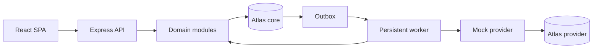

# Pratyaya architecture

Pratyaya is a synthetic payment reliability and agentic-authorization platform. It never processes real cards, bank credentials, customer financial data, or money.

## Boundaries

- JavaScript ES modules across React/Vite and Node.js/Express.
- npm-workspace monorepo.
- Modular-monolith API; separate persistent worker and mock-provider processes.
- MongoDB Atlas/Mongoose is authoritative. Multi-document transactions protect local financial effects.
- Durable queues are MongoDB-backed. Redis/BullMQ requires measured need and a new ADR.
- Shared Zod contracts validate HTTP/event input. Controllers stay thin; domain services own rules; Mongoose models isolate persistence.



## Runtime responsibilities

### Web

The browser renders authenticated operations views and calls same-origin `/api` paths. It contains no financial authority or secrets. Vercel uses a serverless proxy to the API so secure cookie sessions remain same-origin.

### API

The API owns authentication, merchant isolation, RBAC, payments, refunds, ledger, reconciliation, routing, risk, audit, webhooks, sandbox controls, and AgentPay approval. Every resource read/write derives merchant scope from authenticated server state. Controllers delegate to domain services.

### Worker

The continuously running worker conditionally leases outbox documents, creates deterministic jobs, claims jobs with fencing tokens, retries bounded failures, recovers stale leases, and moves exhausted work to dead-letter state. Delivery is at least once; business effects must be idempotent.

### Mock provider

The provider is an independent Express/MongoDB boundary. Requests require a timestamped HMAC signature and provider identity. Its operation key is stable before dispatch. It persists synthetic outcomes and can simulate delays, declines, timeouts, and errors. It never accepts PAN/CVV.

## Data and money

Amounts are positive decimal strings in JSON minor units. Services use `BigInt`; Mongoose persists BSON `Long`/`BigInt`. Floating-point money arithmetic is prohibited. USD and INR are supported without FX.

MongoDB connections disable command buffering, use bounded selection/connect/socket timeouts, and expose separate liveness/readiness semantics. Core and provider deployments use independent least-privilege users and distinct databases, preferably separate Atlas projects/clusters.

## Idempotency and concurrency

Idempotency uniqueness is scoped by merchant and operation. A canonical payload fingerprint distinguishes a replay from key reuse with a different request. Unique indexes arbitrate concurrent first writers. Versioned/conditional writes match merchant, current state, and version; a lost race returns conflict rather than overwriting state.

Outbox relay first acquires a conditional lease. Every outbox event maps to a deterministic job ID even when an upstream fingerprint is absent. Job claims include owner, lease expiration, and token. Duplicate queue/webhook delivery is expected; Pratyaya does not claim global exactly-once execution.

## Provider uncertainty

A provider operation ID is persisted before any outbound call and reused as the provider-side operation identity. A timeout is `UNKNOWN`, not failure. Reconciliation looks up the original identity; it never creates a fresh operation at a different provider after an uncertain dispatch.

No database transaction spans Pratyaya and the provider. The current orchestration implementation still holds a local MongoDB transaction callback open across provider HTTP waits; this is a documented production-hardening gap because it can lengthen transaction lifetime. The target design uses three phases: transactionally mark dispatch/in-flight, perform HTTP outside the transaction, then transactionally apply the confirmed/unknown result.

## Ledger

Journals are append-only. Each contains at least two entries, one currency, and equal debit/credit totals. Authorization alone posts no settled journal. Confirmed capture debits provider clearing and credits merchant payable; refund posts a compensating journal. Corrections append new journals rather than editing posted records.

Payment state, journal, ledger event, audit information, and outbox effects that belong to one local financial decision commit atomically. Unique business references prevent duplicate posting. Integrity checks detect imbalance, missing journals, currency mismatch, and refund overage.

## Security

- JWT access tokens and rotated hashed refresh tokens use HttpOnly cookies; cookie mutations require CSRF double submit.
- Production requires HTTPS, secure cookies, exact CORS origins, trusted-proxy configuration, Helmet, body limits, and rate limiting.
- Logs are structured and must not include connection strings, tokens, passwords, HMAC keys, or sensitive payloads.
- Provider/webhook signatures use raw bytes, timestamp tolerance, timing-safe comparison, and replay/deduplication records.
- Chaos functions remain sandbox/admin-only. Public production exposure is forbidden.
- AI may draft proposals only. A separately authenticated human approves an exact immutable proposal; the server re-evaluates deterministic policy at execution.

## Deployment

Vercel hosts the SPA and same-origin API proxy. Render hosts API/provider web services plus a paid persistent background worker. Atlas supplies TLS replica-set persistence. Hosting secrets remain in platform stores. Health checks are `/api/v1/health/ready`, provider `/health/ready`, and worker `/health/ready` when directly reachable.

No deployment is considered successful until all HTTPS services are healthy and `npm run smoke:deployment` verifies all four role flows. See `docs/deployment.md`.

## Verification gates

```bash
npm run format:check
npm run lint
npm test
npm run build
npm run db:check
npm run test:integration
npm run deploy:check
```

Only observed results belong in `docs/PROGRESS.md` and `RESUME_EVIDENCE.md`. A skipped integration suite, config file, or local smoke run is not proof of a hosted deployment.
