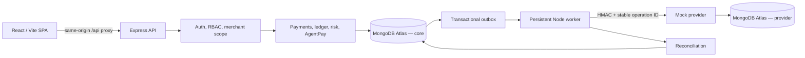
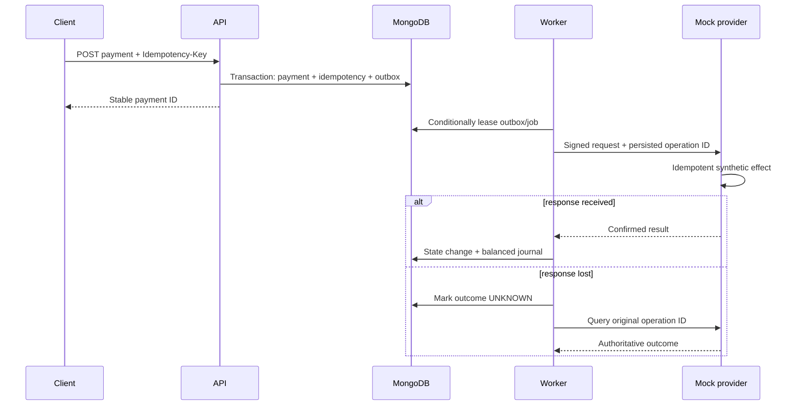

# Pratyaya

Pratyaya is a synthetic payment reliability and agentic-authorization lab. It demonstrates idempotent payment APIs, merchant isolation, durable background work, provider uncertainty, reconciliation, and double-entry accounting without accepting real payment credentials or moving money.

> **Simulation only:** use fictional merchants, users, invoices, tokens, and amounts. Pratyaya is not a gateway, bank, PCI-certified system, or production financial product.

## What is implemented

- React/Vite operations UI with login, credential-free Explore-as-role flows, payment, ledger, routing, risk, reliability, webhook, and AgentPay views.
- Express modular-monolith API using JavaScript ES modules, Zod validation, structured errors, request IDs, rate limits, Helmet, CORS, JWT sessions, HttpOnly cookies, CSRF protection, RBAC, and merchant-scoped queries.
- MongoDB Atlas persistence through Mongoose, with replica-set transactions for multi-document financial effects.
- Merchant-scoped idempotency records with canonical request fingerprints and unique indexes.
- Append-only double-entry journals with debit/credit and currency balance checks.
- MongoDB transactional outbox, deterministic jobs, conditional leases, retries, stale-job recovery, and dead-letter states.
- Independent mock provider with HMAC-authenticated requests, idempotent operations, provider-side persistence, and synthetic timeout/decline/error modes.
- Reconciliation, provider routing/health, webhook inbox deduplication, risk rules, and human-approved AgentPay proposal flows.
- OpenAPI, Docker Compose, GitHub Actions, Vercel configuration, Render Blueprint, deployment validation, and hosted smoke-test scripts.

Implementation does not equal production certification. Current engineering limitations are listed below and in [the deployment guide](docs/deployment.md).

## Architecture



The API is a modular monolith. The worker and mock provider are separate processes because they have different availability and security boundaries, not because every domain needs a service. MongoDB is authoritative; Redis/BullMQ is intentionally absent until measured demand and an ADR justify it.

### Payment safety model



Money enters JSON as positive decimal strings in minor units, is converted to `BigInt`, and is persisted as BSON `Long`/Mongoose `BigInt`. Floating-point arithmetic is not used for financial amounts. A timeout is `UNKNOWN`, never an assumed failure, and retries retain the same provider operation identity.

## Repository

```text
apps/
  api/             Express API and domain modules
  worker/          durable outbox/job consumer
  mock-provider/   independent synthetic provider
  web/             React/Vite frontend
packages/shared/   Zod contracts, constants, money helpers
api/               Vercel same-origin API proxy
docs/              architecture, security, testing, deployment, ADRs
scripts/           deployment validation and hosted smoke checks
render.yaml        API/provider/worker Render Blueprint
vercel.json        frontend and proxy configuration
```

## Run locally

Prerequisites:

- Node.js 24 and npm 11
- two MongoDB Atlas database users/URIs, each on a replica-set deployment that supports transactions
- Atlas network access restricted to your development/deployment egress addresses
- Docker only if using the Compose workflow

```bash
git clone https://github.com/alive7z/Pratyaya.git
cd Pratyaya
npm ci
cp .env.example .env
```

Set the two Atlas URIs and replace all development signing secrets in the untracked `.env`. Never use a `VITE_` variable for a secret.

```bash
npm run db:check
npm run db:migrate:provider
npm run seed:demo
npm run dev
```

Local endpoints:

| Service       | URL                                  |
| ------------- | ------------------------------------ |
| React         | `http://localhost:5173`              |
| API           | `http://localhost:4000/api/v1`       |
| OpenAPI UI    | `http://localhost:4000/api-docs`     |
| Mock provider | `http://localhost:4100`              |
| Worker health | `http://localhost:4200/health/ready` |

Docker uses the same Atlas-backed `.env`:

```bash
docker compose --env-file .env up --build
```

## Verification

```bash
npm run format:check
npm run lint
npm test
npm run build
npm run db:check
npm run test:integration
npm run deploy:check
```

Unit tests do not require Atlas. Database and integration commands do and must target synthetic test databases. See [testing](docs/testing.md) and [verified evidence](RESUME_EVIDENCE.md); neither this README nor CI treats skipped Atlas jobs as a passing integration run.

## Recruiter demo walkthrough

1. Open `/login` and choose **Explore as Merchant**. Create a fictional payment and inspect its state and timeline.
2. Retry the same logical request with the same idempotency key; show that it maps to one payment. Change the payload with that key; show the conflict.
3. Inspect the ledger journal and demonstrate equal debit and credit totals for one currency.
4. Choose **Explore as Developer**. Open provider health, webhooks, and the Reliability Lab; inject a sandbox-only timeout and explain why the outcome is uncertain rather than failed.
5. Choose **Explore as Risk Analyst** to review risk decisions, then **Explore as Admin** for reconciliation and integrity views.
6. Open AgentPay: a proposal may be drafted, but execution requires a separate authenticated approval and a final server-side policy check.

The automated smoke command checks all four role sessions, `/auth/me`, each role dashboard, logout/CSRF, frontend HTML, and service readiness:

```bash
PRATYAYA_WEB_URL=https://your-vercel-site.example \
PRATYAYA_API_URL=https://your-render-api.example \
PRATYAYA_PROVIDER_URL=https://your-render-provider.example \
npm run smoke:deployment
```

## Deployment

The prepared topology is:

- Vercel: static React/Vite site and a same-origin serverless proxy; `PRATYAYA_API_ORIGIN` stays server-side.
- Render: one web service for the API, one web service for the mock provider, and one continuously running background worker.
- MongoDB Atlas: separate least-privilege core and provider users/databases; separate clusters/projects are recommended for stronger isolation.

The Render worker cannot be replaced by a request-driven serverless function because durable leases and reconciliation require continuous polling. The Blueprint uses three paid `0.5c-512mb` instances. Current provider pricing and operational caveats are recorded with source links in [docs/deployment.md](docs/deployment.md).

No public deployment URL is claimed in this repository. Deployment is complete only after `npm run smoke:deployment` passes against actual HTTPS URLs.

## Security boundaries

- Secrets are environment-only and redacted from logs/system endpoints.
- The browser receives no Atlas URI, JWT signing key, or provider HMAC secret.
- Hosted cookies are `Secure`, `HttpOnly`, and protected by CSRF validation; HTTPS and explicit CORS origins are required.
- Provider requests use timestamped HMAC-SHA256 signatures and timing-safe comparison.
- Role checks and merchant filters are server-side. UI route guards are convenience, not authorization.
- Chaos endpoints are synthetic sandbox/admin tools and must not be exposed in a public production environment.
- Never submit PAN, CVV, bank credentials, personal data, or real invoices.

See [the threat model](docs/threat-model.md) and [financial invariants](docs/financial-invariants.md).

## Current limitations

- No public deployment has been performed or verified from this workspace; account ownership, billing, DNS, and provider dashboards require the repository owner.
- The supplied Atlas development configuration currently resolves both process URIs to a database named `test`; production must use separate least-privilege database users and distinct database names, preferably isolated clusters.
- Provider HTTP calls currently occur inside orchestration transaction callbacks. This works in the synthetic test flow but can extend MongoDB transaction duration during provider latency; splitting dispatch and completion into separate transaction phases is a production-hardening item.
- The UI test suite is component/API-mock based. There is no Playwright browser suite or checked-in screenshot set, so screenshots are intentionally not fabricated here.
- Performance/load figures are not claimed. Test durations are verification timings, not service latency benchmarks.

## Documentation

- [Architecture](PAYCORE_ARCHITECTURE.md)
- [Deployment and costs](docs/deployment.md)
- [OpenAPI](docs/openapi.yaml)
- [Testing](docs/testing.md)
- [Progress](docs/PROGRESS.md)
- [Verified resume evidence](RESUME_EVIDENCE.md)

License and support terms have not been defined. Review the code and limitations before reuse.
