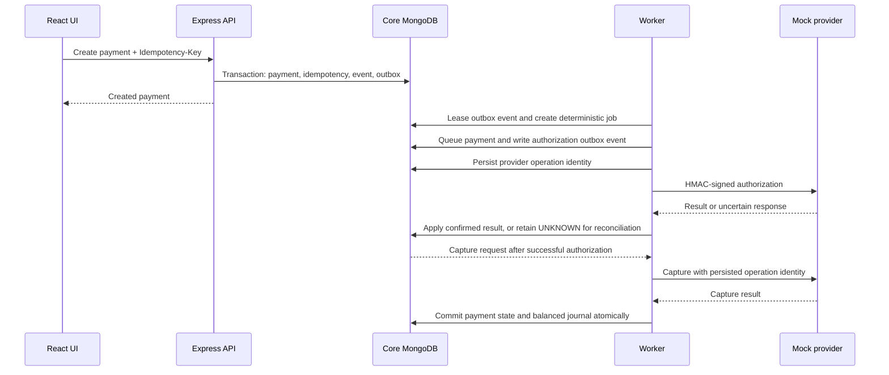

# System architecture

Pratyaya is a synthetic payment platform in an npm-workspace monorepo. Its Express API is a modular monolith. The React frontend, durable worker, and mock provider run as separate processes. MongoDB Atlas is the persistence layer; Redis and BullMQ are not currently used.

## Components

| Process                              | Responsibility                                                                                        | Data boundary                                      |
| ------------------------------------ | ----------------------------------------------------------------------------------------------------- | -------------------------------------------------- |
| Web (`apps/web`)                     | React/Vite operations UI and role-based views                                                         | Calls the API; stores no financial source of truth |
| API (`apps/api`)                     | Authentication, RBAC, merchant-scoped payment, refund, ledger, risk, routing, and AgentPay operations | Core MongoDB database                              |
| Worker (`apps/worker`)               | Outbox relay, leased job processing, provider dispatch, retries, reconciliation, and webhook delivery | Core MongoDB database                              |
| Mock provider (`apps/mock-provider`) | Signed synthetic authorization, capture, refund, and operation lookup endpoints                       | Provider MongoDB database                          |

The web app can use the same-origin `/api` proxy in a hosted deployment. Local development can call the API directly. The provider has its own HTTP and persistence boundary, but is simulation code and never contacts a real payment network.

## Payment and work flow

The `PAYMENT_CREATED` outbox event is converted to a job. Processing that job queues authorization work; a successful authorization produces an automatic capture request. Provider calls happen after the operation record has been committed. Result application uses a separate MongoDB transaction.

## Reliability and financial boundaries

- The API stores a payment, its idempotency result, payment event, and initial outbox event in one MongoDB transaction.
- The worker uses stable job IDs, conditional leases, lease tokens, retry backoff, stale-lease recovery, and dead-letter status. Delivery is at least once; the design does not claim global exactly-once execution.
- Provider operations are persisted before dispatch. A timeout is recorded as unknown; reconciliation queries the same operation ID rather than creating a new financial effect.
- A confirmed capture or refund changes payment and refund state and posts its journal in one transaction. A provider response by itself is not a journal entry.
- Ledger totals are derived from immutable posted journals. A reconciliation record or integrity report is diagnostic and does not rewrite accounting history.
- Demo fault injection is scoped to demo merchants and is rejected in production configuration.

## Source and related documents

- [API bootstrap and route mounts](../apps/api/src/app.js)
- [Payment creation and outbox write](../apps/api/src/modules/payments/payment.service.js)
- [Provider operation orchestration](../apps/api/src/modules/payments/operations/payment-orchestrator.service.js)
- [Worker job processing](../apps/worker/src/modules/jobs/job-processor.js)
- [Worker leases and outbox relay](../apps/worker/src/modules/jobs/job.service.js)
- [Financial invariants](financial-invariants.md)
- [Deployment topology](deployment.md)
