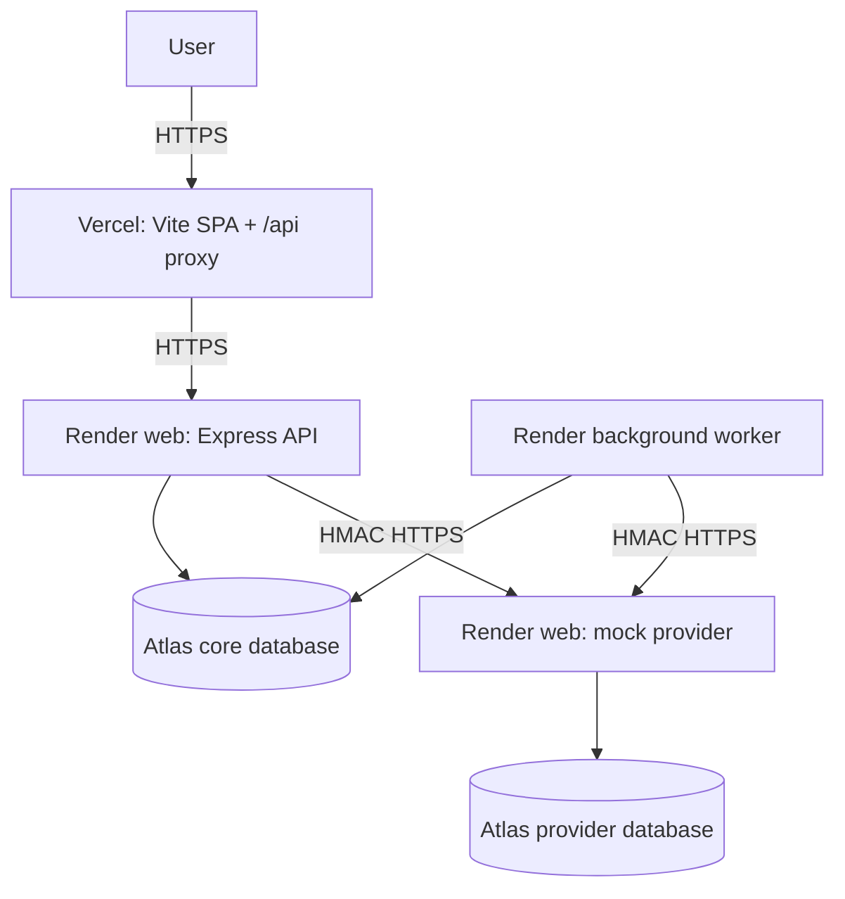

# Deployment guide

## Target topology



`vercel.json`, `api/[...path].js`, and `render.yaml` are deployment inputs. The Vercel proxy keeps browser requests same-origin so secure cookie sessions do not depend on cross-site cookie behavior. `PRATYAYA_API_ORIGIN` is server-only.

## Hosting fit and cost

Pricing changes; confirm it in each provider dashboard before provisioning.

| Component       | Prepared plan                                 | Why                                                    | Published price checked 2026-10-24                                                                 |
| --------------- | --------------------------------------------- | ------------------------------------------------------ | -------------------------------------------------------------------------------------------------- |
| Vercel frontend | Hobby for a personal, noncommercial portfolio | Vite static hosting and serverless proxy               | $0; Pro shown as $20/month                                                                         |
| Render API      | `0.5c-512mb` web service                      | Continuous Express process and health checks           | $7/month                                                                                           |
| Render provider | `0.5c-512mb` web service                      | Independent provider boundary                          | $7/month                                                                                           |
| Render worker   | `0.5c-512mb` background worker                | Continuous polling/leases; no inbound request required | $7/month                                                                                           |
| Atlas           | M0 for limited demos or dedicated M10+        | Replica-set transactions and managed TLS               | M0 free; M10 base shown as $0.08/hour (~$58.40/730h), excluding region/transfer/backup differences |

Render's free web service spins down after inactivity and Render does not offer free background workers. A request-driven function is not a compatible substitute for the current persistent polling worker. Budget at least $21/month for the three Render instances, plus the chosen Atlas tier and any usage/transfer charges.

Sources: [Render background workers](https://render.com/docs/background-workers), [Render free limitations](https://render.com/docs/free), [Render compute plans](https://render.com/docs/compute-plans), [Vercel Vite](https://vercel.com/docs/frameworks/frontend/vite), [Vercel pricing](https://vercel.com/pricing), [Atlas pricing](https://www.mongodb.com/pricing).

## Atlas

1. Create a core database user scoped only to the Pratyaya core database.
2. Create a separate provider user/database. Separate projects/clusters are preferred for a true external boundary.
3. Restrict the Atlas IP access list to known deployment egress ranges where the hosting plan makes them available. Avoid `0.0.0.0/0`; if temporarily required for dynamic egress, use least-privilege users, TLS, monitoring, and rotate credentials afterward.
4. Put the full SRV URIs only in Render secret environment variables.
5. Run `npm run db:check`, then the provider migration, against the intended synthetic databases before enabling traffic.

Atlas security reference: [MongoDB Atlas network security](https://www.mongodb.com/docs/atlas/architecture/current/network-security/).

## Render environment

Create the Blueprint from `render.yaml`. Set secret prompts:

- API: `MONGODB_URI`, `AUTH_JWT_SECRET`, `CORS_ORIGINS`
- Provider: `PROVIDER_MONGODB_URI`, `MOCK_PROVIDER_HMAC_SECRET`

The worker receives only the core URI and provider HMAC secret through Render service references. Generate independent random secrets of at least 32 characters. Do not copy development values.

Set `CORS_ORIGINS` to the exact Vercel HTTPS origin. Render supplies `PORT`; each web process honors it and binds `0.0.0.0`. The API trusts one hosting proxy and uses secure cookies in production. Render terminates managed TLS for web services; readiness paths are configured as `/api/v1/health/ready` and `/health/ready`.

The provider pre-deploy command runs the narrowly scoped index migration. Auto-deploy waits for passing GitHub checks.

## Vercel environment

Import the repository, retain the checked-in build configuration, and set:

- `PRATYAYA_API_ORIGIN=https://<api-service>.onrender.com` for Production and Preview as appropriate
- optionally `VITE_API_DOCS_URL=https://<api-service>.onrender.com/api-docs` (public value only)

Do not expose Atlas credentials, JWT secrets, or provider secrets as `VITE_*`. Vercel environment variables are managed separately per environment: [Vercel environment variables](https://vercel.com/docs/environment-variables).

## Release verification

```bash
npm ci
npm run verify
npm run db:check
npm run test:integration
npm run deploy:check
```

After both platforms report healthy:

```bash
PRATYAYA_WEB_URL=https://<vercel-host> \
PRATYAYA_API_URL=https://<render-api-host> \
PRATYAYA_PROVIDER_URL=https://<render-provider-host> \
npm run smoke:deployment
```

Manually verify responsive navigation, keyboard focus, each role's visible permissions, no sensitive values in browser bundles/network responses, and a synthetic payment/ledger trace. Record screenshots only after the deployed UI is verified.

## Rollback and incident handling

- Roll back Vercel/Render to the last verified commit; do not roll back financial collections by deleting records.
- Pause synthetic intake before worker/API changes that alter operation semantics.
- Preserve uncertain provider operations and reconcile by their original IDs.
- Rotate any exposed credential immediately in Atlas/Render/Vercel, redeploy, and invalidate relevant sessions.
- Treat readiness failure, dead-letter growth, reconciliation mismatches, or unbalanced journal detection as release blockers.

## Current deployment status

No hosting accounts or production URLs were available in the workspace on 2026-10-24. Configuration was validated locally, but a public deployment and hosted smoke run are **not verified**. The repository therefore publishes no working hosted URL.
