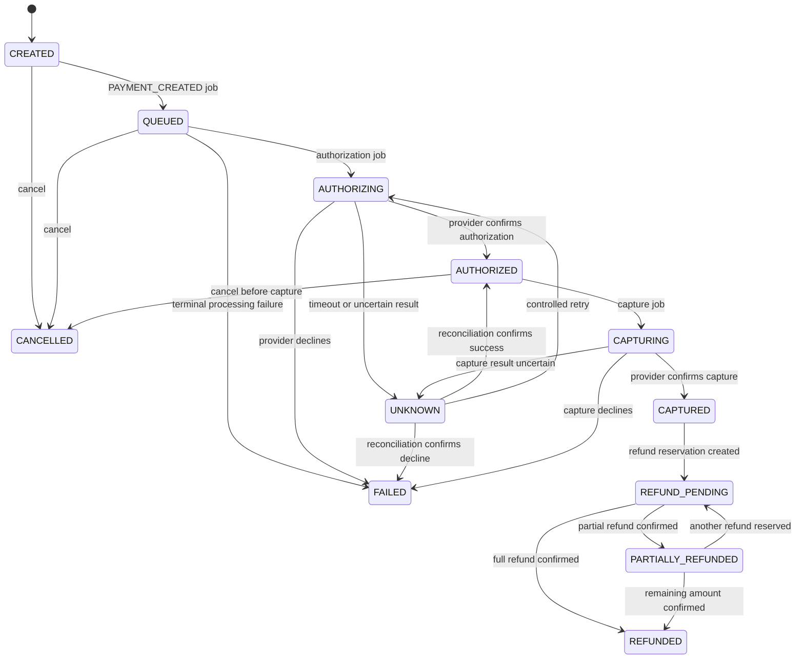

# Payment and operation states

Payment state is stored on the payment document. Provider-operation and refund state are separate records: an `UNKNOWN` payment or operation means the provider outcome is unresolved, not that it failed.

## Payment lifecycle

The authoritative transition allowlist is [`payment.state-machine.js`](../apps/api/src/modules/payments/payment.state-machine.js). Updates include merchant ID, expected state/version, and a MongoDB session; a concurrent state change is rejected instead of overwritten.

## Asynchronous processing

1. `POST /api/v1/payments` creates a `CREATED` payment, an idempotency record, a timeline event, and a `PAYMENT_CREATED` outbox event in one transaction.
2. The worker relays the event to a deterministic job and moves the payment to `QUEUED`.
3. Authorization processing persists a provider-operation ID before sending the signed request.
4. A confirmed authorization emits a capture request. The default automated path captures the authorized amount.
5. A confirmed capture posts the payment update and balanced ledger journal in a transaction.
6. If a provider result is uncertain, the operation/payment remains unresolved and a reconciliation job queries the original provider operation identity.

Refund requests create a separate refund record and reserve refundable capacity. A pending or unknown refund continues to count against the remaining amount. Provider confirmation is required before confirmed refunded totals and refund journal entries advance.

## Other state sets

| Record             | States                                                                                 |
| ------------------ | -------------------------------------------------------------------------------------- |
| Provider operation | `PENDING`, `IN_FLIGHT`, `SUCCEEDED`, `FAILED`, `CANCELLED`, `UNKNOWN`, `MANUAL_REVIEW` |
| Refund             | `REQUESTED`, `QUEUED`, `PROCESSING`, `SUCCEEDED`, `FAILED`, `UNKNOWN`, `CANCELLED`     |
| Worker job         | `PENDING`, `PROCESSING`, `COMPLETED`, `RETRY`, `DEAD_LETTER`                           |
| Outbox event       | `PENDING`, `PROCESSING`, `DISPATCHED`, `FAILED`                                        |

These enums are defined in [`packages/shared/src/constants.js`](../packages/shared/src/constants.js). A retried request must retain its idempotency key and provider operation identity. See [worker leases and retries](architecture.md#payment-and-work-flow) and [financial invariants](financial-invariants.md).
